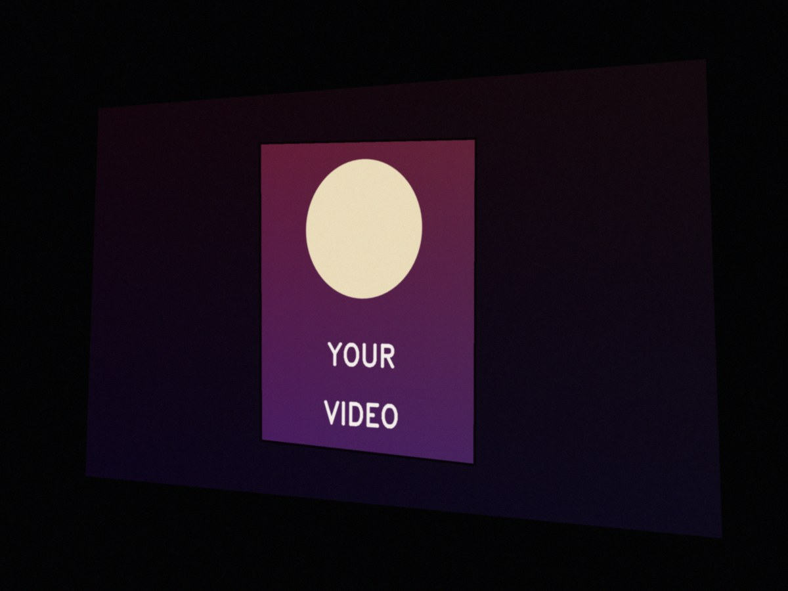
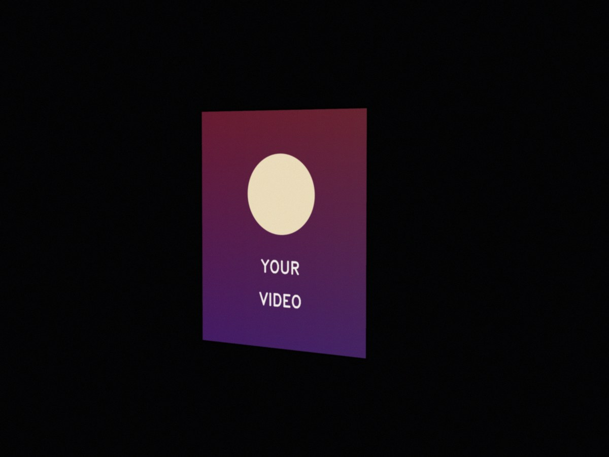
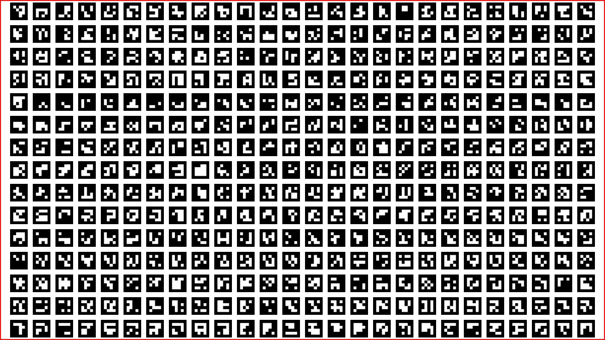
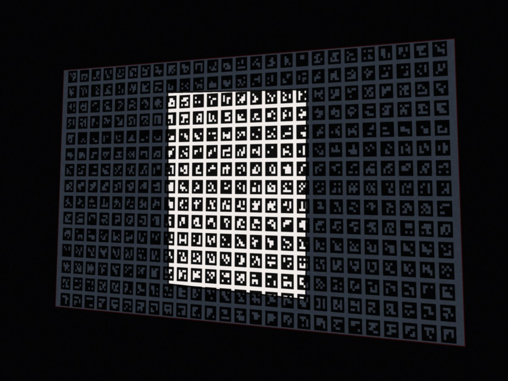
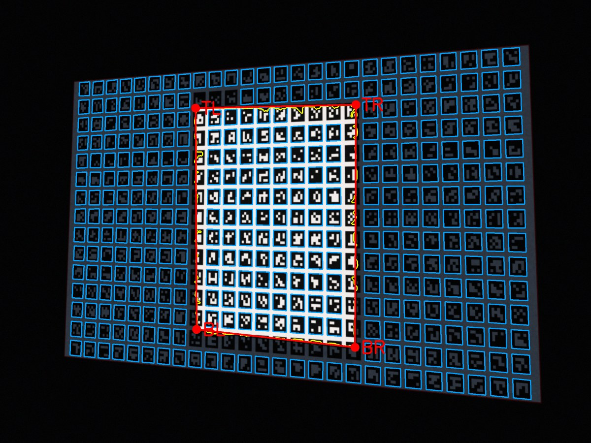
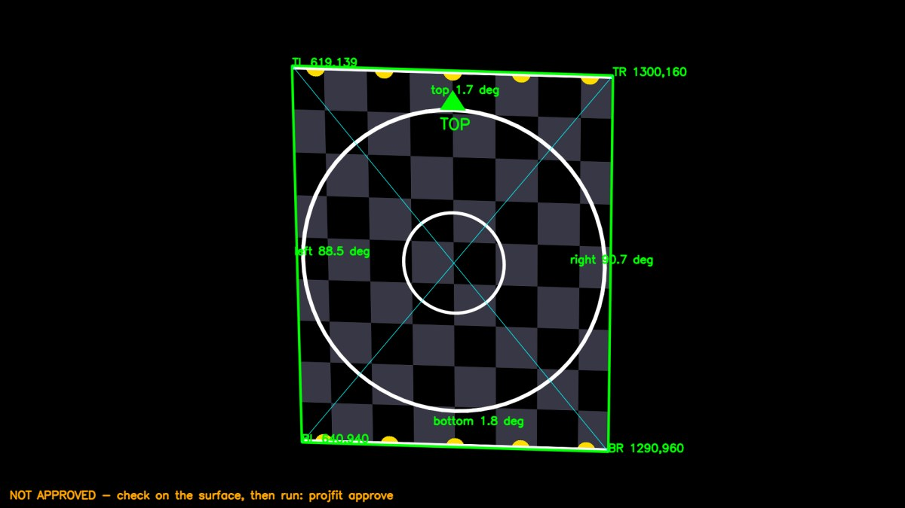
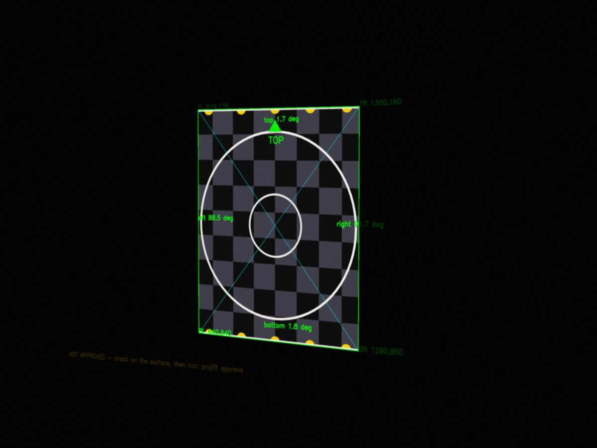

# projection-fit

[](https://github.com/joe-pero/projection-fit/actions/workflows/tests.yml)

**Fit projected video onto a real door, window or wall from one phone photo, with no dragging corners by eye.**

| Before: the video spills everywhere | After: fitted to the surface |
|---|---|
|  |  |

Projection mapping for home haunts, holiday displays and small events usually means standing
in the yard nudging corners in software until it looks about right. Then the projector gets
bumped and you do it again.

`projfit` does the measuring for you:

1. **Project a marker card.** A grid of ArUco markers (QR-like squares). Each one has a unique
   ID, so the tool knows exactly where every marker came from in the projector's picture.
2. **Take one photo** from where your audience stands.
3. **The tool finds your surface** and works out precisely where its corners sit in projector
   pixels. It also works out the surface's true shape, so your video is cropped to fit,
   never stretched.
4. **A person checks it.** The tool makes a test pattern to project. You look at it on the real
   surface: circles round, squares square, border on the edges.
5. **Approve and render.** Only an approved fit can render your videos.

## The steps, in pictures

| 1. Marker card | 2. Your photo | 3. What the tool read |
|---|---|---|
|  |  |  |

| 4. Check pattern | 5. Check pattern on the surface | 6. Your video, fitted |
|---|---|---|
|  |  |  |

*All pictures here come from a synthetic test scene (`examples/make_demo.py`), so the right
answer is known exactly. On this scene the corners land within 0.6 projector pixels.*

## Why a person stays in the loop

The tool is accurate, but it's measuring a photo, and photos can mislead: a reflection, a
marker hidden by a wreath, a projector bumped after the photo was taken. So the workflow has
a gate. `projfit warp` refuses to render until someone has projected the check pattern, looked
at it on the real surface and run `projfit approve`. The approval records who checked it and
when. A fit that raised warnings needs an explicit `--accept-warnings`.

The tool also refuses to hand back answers that can't be right (a tiny surface, corners far
outside the picture, a shape that isn't a proper four-sided outline) instead of guessing.

## Install

Needs Python 3.9+, and `ffmpeg` for video output.

```bash
git clone https://github.com/joe-pero/projection-fit
cd projection-fit
pip install -e .
```

## Use

```bash
# 1. Marker card for your projector's picture (as the audience sees it)
projfit markers --size 1920 1080 -o card/ --video
#    Projector on its side? Describe the upright picture and how the file is turned:
#    projfit markers --size 1080 1920 --rotate 90 -o card/

# 2. Play card/markers.png (or .mp4) on the projector, take one photo, then:
projfit fit photo.jpg --layout card/layout.json -o fit/
#    Best results: give the surface's measured size (any unit), e.g. a 36 x 80 inch door
projfit fit photo.jpg --layout card/layout.json --size-real 36 80 -o fit/

# 3. Project the check pattern and look at it on the surface
projfit verify fit/fit.json --video

# 4. If it looks right
projfit approve fit/fit.json --by "Your Name"

# 5. Fit your videos
projfit warp fit/fit.json door_scene.mp4 door_scene_fitted.mp4
```

`projfit fit` also writes `photo_read.jpg`, showing the markers it read (blue) and the surface
outline it found (red). If auto-detection struggles, give the four corners yourself in photo
pixels: `--corners x1 y1 x2 y2 x3 y3 x4 y4`. You'll still get the precise marker-based mapping.

Prefer the by-eye method too? `projfit grid --layout card/layout.json --fit fit/fit.json`
makes a labelled coordinate grid with the fitted outline drawn on it.

## Tips

- **Darken the scene** and turn off porch lights for the photo. The projector should be the brightest thing.
- **Fill the frame.** Markers need to be about 25 pixels across in the photo to read. If they're
  too small, use `--marker 80 --pitch 100`.
- **Shoot from the audience's spot**, not from beside the projector.
- **Light surfaces work best.** A white sheet, painted door or blind gives a crisp edge.
  The tool finds the light surface against a darker surround.
- **Re-fit after the projector moves.** It takes one photo.

## How it works

1. Markers are detected with sub-pixel corner refinement. Each detected corner is an exact
   photo-to-projector point pair. Markers that don't sit on the main plane (a step, a side
   wall) are dropped with RANSAC.
2. **Finding the surface.** The tool knows which pixels of the card are white, so it measures the
   surface's lightness only at those pixels and fills in across the black squares. Markers are
   split into "on the light surface" and "on the dark surround" by the brightness of their white gaps.
3. **Sharpening the edges.** Each side is refined by walking straight across it and taking the
   exact light-to-dark crossing wherever a known-white pixel sits on both sides of the edge.
   This took the corner error on the test scenes from about 9 pixels to under 1.5.
4. **Each corner is mapped** into projector pixels using the markers nearest that corner, which
   copes with surfaces that aren't perfectly flat.
5. **True shape.** From a measured size if given, otherwise from the photo itself using the
   camera's focal length stored in the photo (the single-view rectangle method of Zhang & He).
6. **Video is centre-cropped** to that shape, warped onto the corners with ffmpeg, and masked
   black everywhere else.

## Tests

```bash
python3 -m unittest -v
```

The tests render synthetic photos of a projected card on a lit surface, including through a
simulated phone camera, and check the answer against the known truth. They cover corner
accuracy, manual corners, aspect from the photo, the approval gate, and video output for a
sideways projector.

## Background

I built the first version of this to fit Halloween scenes onto my front door, after a season
of fitting projections by eye. This is the general-purpose version. The rest of that build is
in [harvest-of-shadows](https://github.com/joe-pero/harvest-of-shadows).

Built with AI coding assistance (Anthropic Claude), directed and tested by me.

## License

MIT
